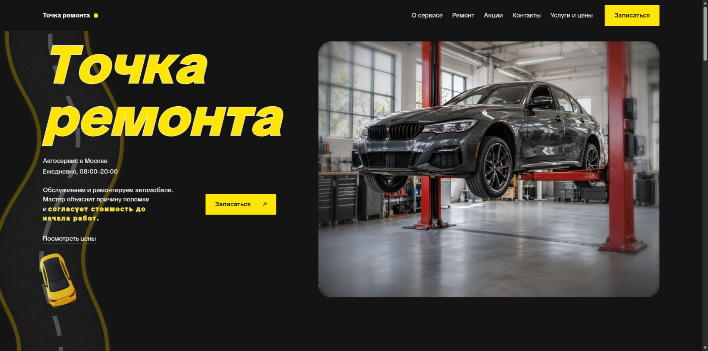
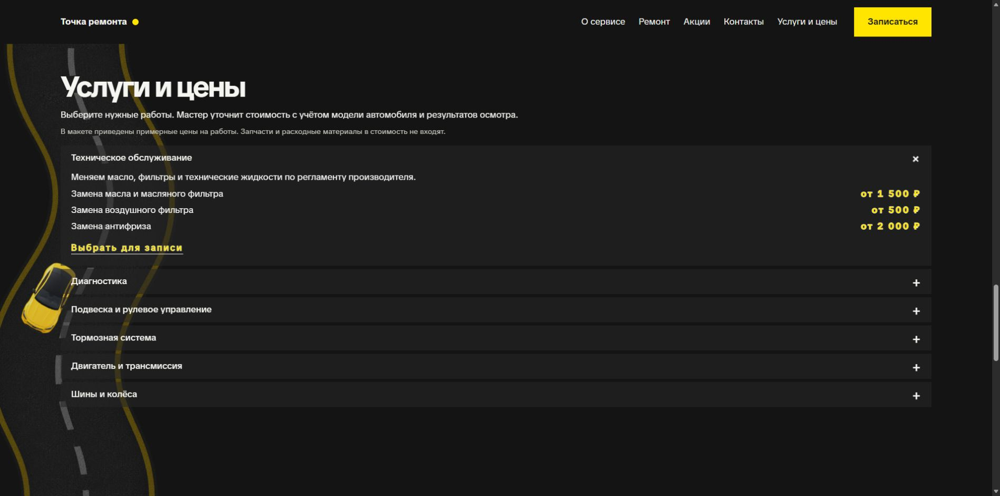

# Лендинг автосервиса

[Открыть лендинг](http://193.187.96.95:8001/#home) · [Все разделы на скриншотах](docs/screenshots.md)

Одностраничный сайт помогает водителю понять, как проходит ремонт, посмотреть стоимость работ и выбрать услугу для записи. Прайс, акции и форма доступны на одной странице, в том числе с телефона.



## Возможности

| Раздел | Что в нём можно сделать |
| --- | --- |
| Главная и «О сервисе» | Узнать, какие работы выполняет сервис и как мастер согласует их с водителем. С первого экрана можно перейти к ценам или записи. |
| Как проходит ремонт | Посмотреть этапы от обсуждения симптомов и диагностики до согласования сметы и выдачи машины. |
| Услуги и цены | Раскрыть одну из шести категорий. Кнопка «Выбрать для записи» подставляет услугу в форму. |
| Акции | Посмотреть примеры предложений и выбрать одно для записи. |
| Контакты | Найти график работы и место для контактных данных. |
| Запись | Выбрать услугу, указать автомобиль и описать проблему. Поля проверяются в браузере, а ошибки показаны рядом с полями. |

Цены, предложения и контакты в опубликованной версии приведены для демонстрации. Форма проверяет введённые значения без отправки и сохранения заявки. Для проверки используйте вымышленные данные.



## Стек

| Технология | За что отвечает |
| --- | --- |
| HTML и CSS | Структура страницы, адаптивная вёрстка, оформление и меню разделов. |
| JavaScript | Выбор услуги, проверка формы и анимации. |
| Node.js 24 | Локальный HTTP-сервер на стандартных модулях. |
| Docker Compose | Запуск в контейнере. |

Сторонних библиотек и отдельного шага сборки нет. Иллюстрации WebP и шрифт TikTok Sans поставляются с проектом. Фотографии ниже первого экрана подгружаются по мере прокрутки. Движение машины и анимация подъёмника учитывают системную настройку уменьшения движения.

## Структура кода

| Путь | Содержимое |
| --- | --- |
| `index.html` | Разделы лендинга, прайс, форма записи и документы для демоверсии. |
| `styles.css` | Оформление, мобильная вёрстка и состояния элементов. |
| `app.js` | Навигация, анимации, подстановка услуги и проверка полей. |
| `assets/` | Иллюстрации, кадры анимации и локальный шрифт. |
| `server.cjs` и `tests/` | Сервер статических файлов и HTTP-тесты. |

## Запуск на компьютере

Для локального запуска нужна копия исходников. Установите Node.js 24 или новее и откройте терминал в корне проекта. Пакеты npm устанавливать не нужно.

```sh
npm start
```

Откройте [локальный лендинг](http://127.0.0.1:4183/#home). На Windows можно дважды нажать `Запустить.cmd`. Для остановки сервера нажмите Ctrl+C.

## Проверка

1. В прайсе раскройте услугу и нажмите «Выбрать для записи». Проверьте, что услуга появилась в форме.
2. Попробуйте проверить пустую форму, затем введите вымышленные имя и номер, отметьте согласие и повторите проверку.
3. На узком экране откройте меню и проверьте переход к прайсу и форме.

```sh
npm run check
npm test
```

Первая команда проверяет синтаксис. Тесты проверяют выдачу страницы и ресурсов, ответ `/healthz` и обработку недоступных маршрутов.
