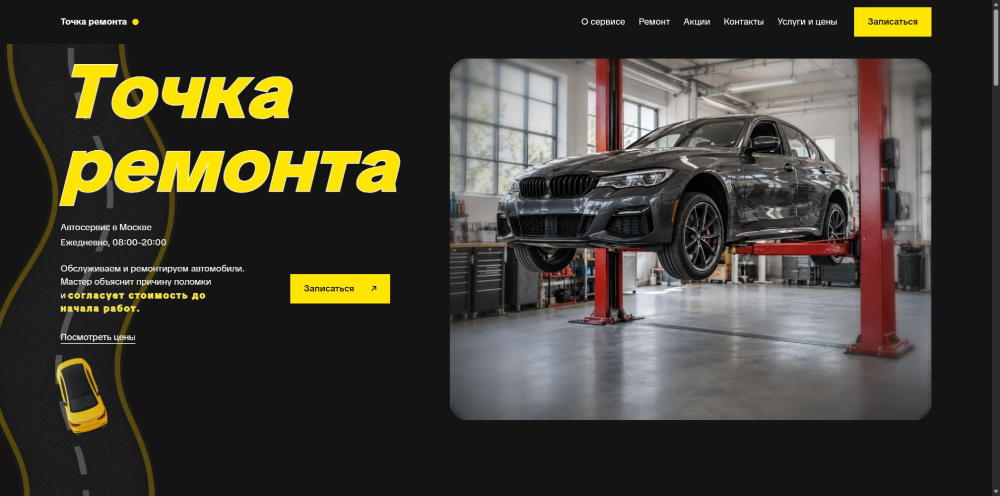
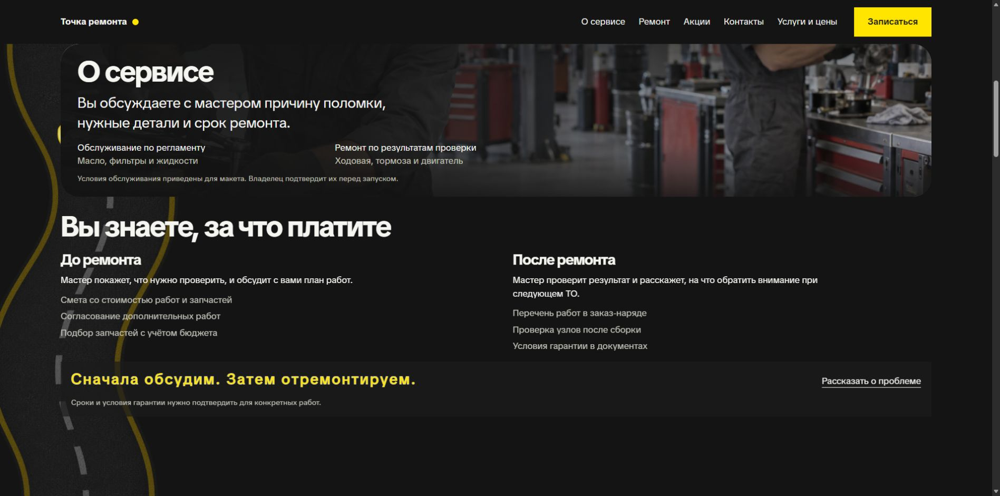
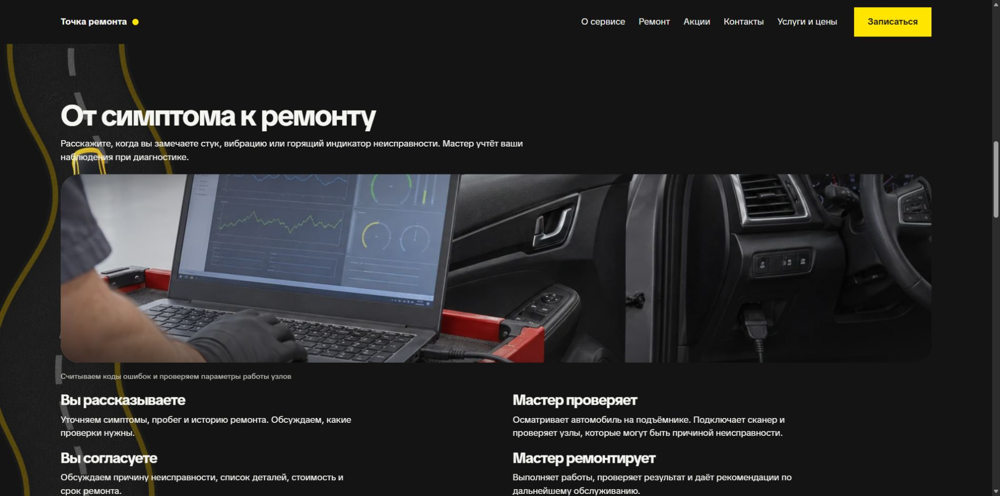
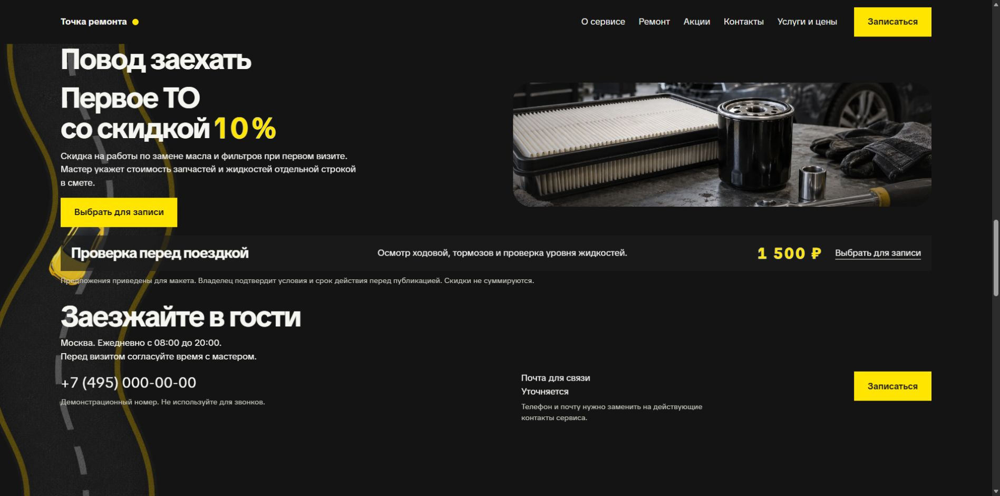
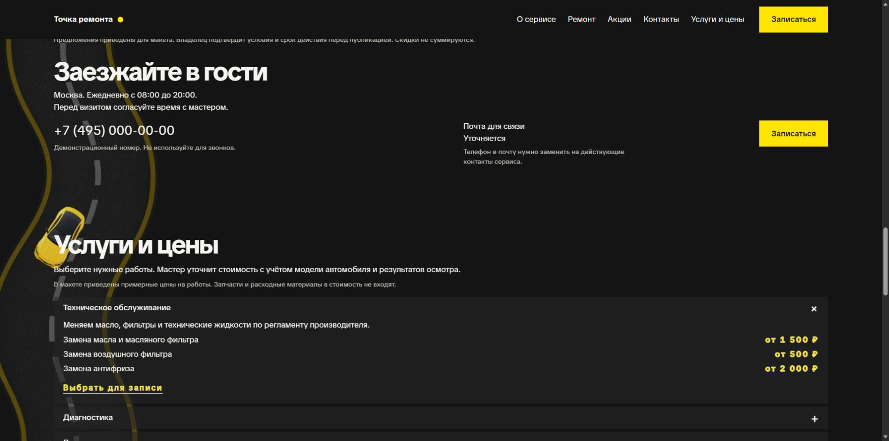
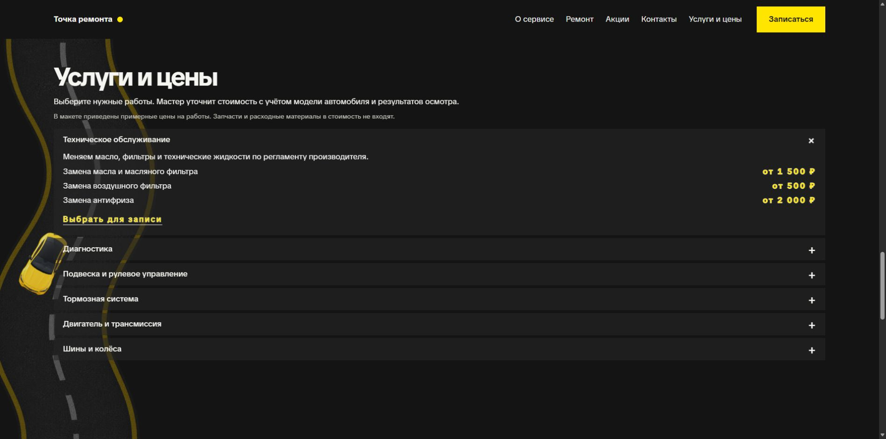
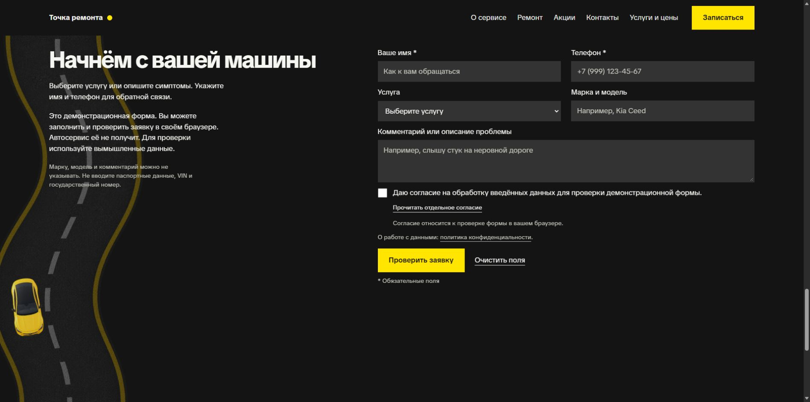
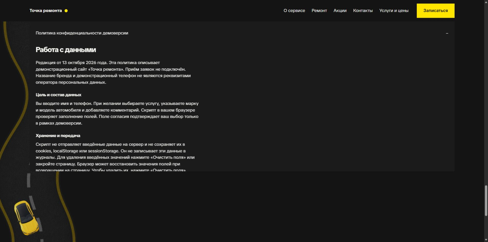
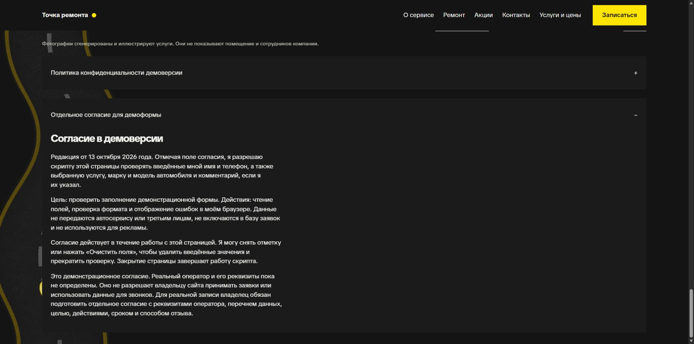

# Разделы лендинга автосервиса

[К описанию проекта](../README.md)

### Главная

Знакомит с сервисом и ведёт к прайсу и записи.

### О сервисе

Коротко рассказывает об обслуживании и ремонте.

### До и после ремонта

Показывает, как согласуют смету и проверяют результат.

### Как проходит ремонт

Описывает четыре шага от симптомов до выдачи машины.

### Акции

Показывает примеры предложений, которые можно подставить в форму.

### Контакты

Показывает часы работы и демонстрационные контакты.

### Услуги и цены

Раскрывающийся прайс по видам работ.

### Запись

Демонстрационная форма с выбором услуги и проверкой полей.

### Политика конфиденциальности

Раскрывающийся блок о работе демоверсии с данными.

### Согласие

Раскрывающийся блок с условиями проверки формы.

